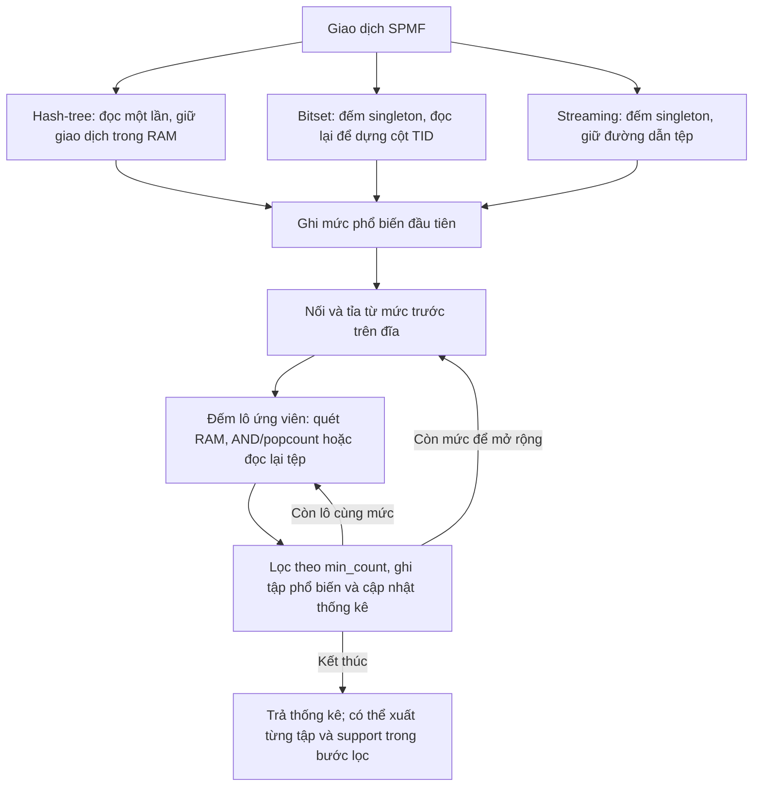

# Chương: Phân tích điểm nghẽn và tối ưu hiệu năng Apriori

## 1. Mục tiêu và phạm vi

Chương này mô tả hai biến thể được xây dựng từ cài đặt Apriori hiện tại của dự án. Cả hai giữ nguyên quy tắc Apriori: sinh ứng viên bằng join/prune, support là số transaction chứa toàn bộ itemset, ngưỡng tỷ lệ được đổi thành `ceil(min_support × N)`, và kết quả phải khớp tuyệt đối theo cặp `itemset → support_count`.

Hai mục tiêu tối ưu được tách riêng:

- **Tối ưu thời gian đếm support:** thay việc duyệt cấu trúc hash-tree theo từng transaction bằng giao các bitmap TID theo từng từ máy.
- **Tối ưu peak RAM:** không nạp toàn bộ database vào RAM; đọc tuần tự file SPMF ở từng lượt khai phá.

Hai hướng này có đặc tính khác nhau. Bitmap thường giảm chi phí CPU khi có đủ RAM cho ma trận bit; streaming giảm phần RAM dành cho database nhưng phải đọc file nhiều lượt.

## 2. Phiên bản hiện tại và các điểm nghẽn

### 2.1. Chuẩn hóa và lưu database trong RAM

Trong `src/apriori.jl`, `mine()` gọi `normalize_transactions()` và tạo `Vector{Vector{Int}}` mới. Mỗi transaction được sort và loại item trùng. Điều này đúng về ngữ nghĩa, nhưng toàn bộ transaction vẫn được giữ trong RAM trong suốt quá trình khai phá.

Ở CLI cơ bản, dữ liệu vừa đọc và kết quả chuẩn hóa của `mine()` có thể cùng tồn tại. Trong benchmark external, `run_once()` gọi `mine_external(read_spmf(...); normalized=true)`. Hàm dùng trực tiếp database đã đọc. Vì vậy phép so RAM ở mục 6.3 dùng một database giao dịch trong RAM làm mốc.

### 2.2. Đếm support bằng hash-tree vẫn phải quét toàn bộ transaction

Bộ đếm mặc định `:hash_tree` trong `count_candidates()` dựng `HashTree` và `HashQueryWorkspace` cho từng lô ứng viên của mức $k$, sau đó duyệt từng giao dịch để tìm ID của các ứng viên xuất hiện. Chi phí phụ thuộc vào số lô và những nhánh thực sự phải duyệt.

- Mỗi transaction phải cập nhật membership bitmap và truy vấn cây.
- Hash-tree giữ candidate, compressed candidate, node và workspace.
- Mỗi lô có chi phí dựng cây riêng. Một mức có nhiều lô cần quét lại các giao dịch cho từng lô.

Bộ đếm `:scan` tạo `Set(transaction)` cho từng giao dịch trong mỗi lô rồi duyệt tất cả ứng viên của lô, kiểm tra item cho tới khi gặp item vắng mặt hoặc đã kiểm tra hết ứng viên. Scan tránh chi phí dựng cây. Số ứng viên cần thử tăng theo độ lớn của lô.

### 2.3. Candidate generation và số lượng kết quả

Luồng `mine()` dùng `foreach_candidate_batch()` để nối theo tiền tố, kiểm tra tập con rồi chuyển ứng viên kiểu `NTuple{K,Int}` theo lô cho bộ đếm. API thông thường tích lũy kết quả trong `MiningResult.itemsets`. Ba hàm external dùng `foreach_disk_candidate_batch()`, ghi mỗi mức phổ biến ra đĩa và trả số liệu tóm tắt. Tùy chọn `itemset_io` cho phép xuất từng tập và support ngay khi lọc. Khi minsup thấp, cả số ứng viên lẫn số kết quả đều có thể tăng theo cấp số mũ.

## 3. Phiên bản tối ưu 1: Vertical TID Bitmap Apriori

### 3.1. Ý tưởng

Thay vì chỉ lưu transaction theo hàng (horizontal), chuyển các singleton frequent sang biểu diễn dọc (vertical): với mỗi item i, lưu bitmap cho biết transaction nào chứa i.

Ví dụ có 10 transaction, item 4 xuất hiện ở TID 1, 3, 6 và 9. Bitmap của item 4 sẽ có bit bật tại các vị trí đó. Bitmap được đóng gói thành `UInt64`, nên một từ 64 bit biểu diễn tối đa 64 transaction.

Với candidate `{a,b,c}`, các transaction chứa đủ cả ba item chính là giao của ba bitmap:

\[
T(a,b,c) = T(a) \;\&\; T(b) \;\&\; T(c)
\]

Support được tính bằng tổng số bit 1 trong bitmap giao:

\[
\operatorname{count}(a,b,c) = \sum_w \operatorname{popcount}(B_a[w] \& B_b[w] \& B_c[w]).
\]

Trong code, `count_ones(UInt64)` thực hiện popcount. Không tạo bitmap trung gian mới cho mỗi candidate; phép AND được tính trong biến cục bộ trên từng word.

### 3.2. Luồng thực thi

1. Đọc file một lượt để đếm N và support của singleton.
2. Tính `min_count` bằng đúng hàm `support_threshold()` của bản gốc; tạo L1.
3. Chỉ cấp bitmap cho các item thuộc L1. Các item không frequent không thể xuất hiện trong candidate hợp lệ nên không cần bitmap.
4. Đọc file lượt thứ hai; mỗi transaction đặt bit TID vào cột bitmap tương ứng.
5. Sinh ứng viên bằng join/prune. Bản benchmark đọc mức phổ biến trước từ đĩa và xử lý theo lô. Với mỗi ứng viên, AND các cột bitmap rồi đếm bit 1 để có support.
6. Lọc theo ngưỡng. API `mine_bitset()` trả mapping trong RAM. API `mine_bitset_external()` ghi mức mới, cập nhật tổng và fingerprint, rồi tiếp tục tới khi hết ứng viên.

### 3.3. Vì sao hướng này có thể nhanh hơn?

Với N transaction, F singleton frequent và Ck candidate ở mức k, số word bitmap là `ceil(N/64)`. Phần đếm support có chi phí xấp xỉ:

\[
O\left(C_k \times \lceil N/64 \rceil \times k\right).
\]

Các phép AND/popcount hoạt động trên từ máy 64 bit, giảm số vòng lặp so với việc duyệt candidate theo từng transaction. Ma trận bitmap cũng có layout liên tục theo cột, thuận lợi cho truy cập tuần tự.

Để so cùng bước đếm ở mức $k$, gọi $q_b(t)$ là số thao tác tra cây và cập nhật bộ đếm cho giao dịch $t$ ở lô $b$. Sau khi dựng cây cho từng lô, chi phí đếm của Hash-tree tỷ lệ với tổng các $q_b(t)$ trên tất cả các lô và giao dịch. Giá trị này phụ thuộc vào độ dài giao dịch và các nhánh cây được thăm. Bitset dùng lại ma trận đã dựng và xử lý tối đa $k$ từ máy cho mỗi nhóm 64 giao dịch của mỗi ứng viên. Cả hai phiên bản còn có chi phí sinh và tỉa ứng viên. Hệ số tăng tốc của toàn bộ lần chạy được đo ở mục 6.3.

Lợi ích lớn nhất thường xuất hiện khi database có nhiều transaction, số item frequent vừa phải và các lượt đếm hash-tree tốn đáng kể. Tốc độ thực tế còn phụ thuộc số candidate, độ dài transaction, minsup và CPU.

### 3.4. Đánh đổi và giới hạn

Bộ nhớ ma trận bitmap xấp xỉ:

\[
M_{bitmap} = 8 \times F \times \lceil N/64 \rceil\;\text{bytes}.
\]

Con số này chưa bao gồm dictionary ánh xạ item→cột, candidate, kết quả và Julia runtime. Nếu F hoặc N quá lớn, ma trận bitmap có thể tốn RAM. Vì vậy, đây là phiên bản ưu tiên **thời gian**, không phải lựa chọn tốt nhất trong mọi cấu hình RAM.

## 4. Phiên bản tối ưu 2: Streaming / External-memory Apriori

### 4.1. Ý tưởng

Bản hiện tại giữ toàn bộ database trong `Vector{Vector{Int}}`. Bản streaming thay bằng nguồn dữ liệu là đường dẫn file SPMF, parse từng dòng và chỉ giữ một transaction đã chuẩn hóa trong bộ nhớ tại một thời điểm.

Bản Streaming dùng trong benchmark chia ứng viên ở mỗi mức thành các lô. Mỗi lô cần một lượt quét tệp giao dịch để đếm support.

### 4.2. Luồng thực thi

1. Lượt đầu: đọc từng dòng, chuẩn hóa transaction và đếm support singleton; không lưu các transaction.
2. Ghi các tập phổ biến mức 1 ra tệp của mức đó.
3. Sinh ứng viên mức tiếp theo theo lô và dựng hash-tree cho lô hiện tại.
4. Đọc lại tệp giao dịch. Với mỗi giao dịch, tìm các ứng viên xuất hiện bằng `matching_ids!()` và tăng bộ đếm tương ứng.
5. Ghi các tập đạt ngưỡng ra tệp của mức mới. Lặp lại bước đếm với các lô còn lại trước khi chuyển mức.
6. Dừng theo cùng điều kiện của bản gốc.

### 4.3. Vì sao peak RAM giảm?

Bản Streaming giữ giao dịch đang đọc, bộ đếm singleton ở lượt đầu, ứng viên của lô, hash-tree, workspace và chỉ mục tra tập con. Trong luồng external, các mức phổ biến ở trên đĩa. Peak RAM đo toàn tiến trình còn bao gồm runtime Julia và bộ nhớ do bộ quản lý cấp phát giữ lại.

Do đó, phần RAM dành cho transaction giảm từ tỷ lệ với tổng số item xuất hiện trong toàn bộ database xuống tỷ lệ với transaction dài nhất. Đây là cải thiện đáng kể khi database lớn nhưng mỗi transaction tương đối ngắn.

### 4.4. Đánh đổi và giới hạn

Với lô tối đa 10.000 ứng viên như trong benchmark, mỗi mức có $C_k$ ứng viên cần `ceil(C_k / 10000)` lượt quét tệp giao dịch. Tổng số lượt đọc tệp là một lượt đếm singleton cộng số lô không rỗng ở tất cả các mức từ $k=2$. Nếu phải chia nhiều lô, chi phí đọc và phân tích lại các giao dịch có thể làm tăng đáng kể thời gian chạy.

Trên dữ liệu dày ở ngưỡng thấp, số ứng viên lớn làm tăng số lượt đọc lại giao dịch. Số tập phổ biến lớn làm tăng kích thước tệp mức và chi phí tra tập con.

## 5. So sánh ba phiên bản



Sơ đồ mô tả luồng benchmark external. Bộ sinh ở bước nối và tỉa cung cấp từng lô cho bộ đếm. Mức trước được giữ trong khi các lô của mức mới đang xử lý.

Ví dụ dưới đây ghi trực tiếp từng tập mục cùng support bằng API Julia. Người gọi sở hữu và đóng luồng. Bỏ `itemset_io` để chỉ thu số liệu tóm tắt như trong lượt đo.

```julia
using FrequentItemsetMining
mkpath("output")
summary = open("output/retail-bitset.spmf.txt", "w") do io
    mine_bitset_external("data/benchmarks/retail.txt"; min_support="0.05", itemset_io=io)
end
println(summary.itemsets)
```

| Tiêu chí | Bản hiện tại (`hash-tree`) | Tối ưu 1 (`bitset`) | Tối ưu 2 (`streaming`) |
|---|---|---|---|
| Biểu diễn transaction | Toàn bộ database dạng vector các vector | Đọc file, sau đó bitmap dọc cho L1 | Đọc file từng dòng, không giữ database |
| Đếm candidate | Hash-tree truy vấn từng transaction | AND bitmap singleton + popcount | Hash-tree truy vấn từng transaction khi stream |
| Số lượt đọc tệp giao dịch trong benchmark | 1 lượt, sau đó duyệt giao dịch trong RAM cho từng lô | 2 lượt (đếm singleton và dựng bitmap) | 1 lượt đếm singleton + 1 lượt cho mỗi lô ứng viên |
| Mục tiêu chính | Baseline cân bằng | Giảm thời gian đếm support | Giảm peak RAM của database |
| RAM dữ liệu | O(tổng số item xuất hiện) và cấu trúc đếm | O(F × N/64) word bitmap | O(transaction dài nhất) cho phần dữ liệu đầu vào |
| Rủi ro chính | Giữ toàn bộ giao dịch và cấu trúc đếm trong RAM | Bitmap quá lớn khi F×N cao | Mỗi lô ứng viên cần đọc và parse lại input |
| Phù hợp khi | RAM đủ, cần baseline chung | Cần tốc độ và bitmap vừa RAM | RAM giới hạn, file lớn, transaction đọc tuần tự được |

### 5.1. Kỳ vọng theo loại dataset

- **Dữ liệu dày, nhiều candidate:** bitmap có thể giảm đáng kể chi phí đếm nhờ phép AND theo word; tuy nhiên candidate generation vẫn có thể chiếm phần lớn tổng thời gian.
- **Dữ liệu thưa, nhiều item ID nhưng ít singleton frequent:** bitmap chỉ cấp cho L1 nên không bị phụ thuộc vào giá trị lớn nhất của item ID. Nếu F nhỏ, ma trận thường gọn.
- **Dataset có N rất lớn:** streaming có ưu thế về RAM vì không materialize toàn bộ transaction; đổi lại sẽ đọc file nhiều lượt.
- **Minsup thấp:** L1 và Ck có thể tăng mạnh. Bitmap cần nhiều cột hơn. Streaming giữ cây và ứng viên theo lô, ghi kết quả theo mức và có thể phải đọc input nhiều lần. Cần đo cả tốc độ lẫn RAM đỉnh.

Đây là kỳ vọng dựa trên cấu trúc dữ liệu và độ phức tạp, không phải số đo thực nghiệm. Kết luận cuối cùng phải dùng CSV do chương trình benchmark sinh trên cùng máy.

## 6. Quy trình đo thực nghiệm

### 6.1. Chạy benchmark

Để tái lập phép đo ở mục 6.3, chạy các lệnh sau từ thư mục gốc dự án. Runner mặc định dùng một lượt khởi động, ba lượt đo, seed 42 và cả ba phiên bản.

```powershell
julia --project=. bin/benchmark-optimized.jl --input data/benchmarks/chess.txt --minsup 0.75 --sample-percentages 100 --output output/chess-apriori.csv
julia --project=. bin/benchmark-optimized.jl --input data/benchmarks/mushrooms.txt --minsup 0.175 --sample-percentages 100 --output output/mushrooms-apriori.csv
julia --project=. bin/benchmark-optimized.jl --input data/benchmarks/retail.txt --minsup 0.05 --sample-percentages 100 --output output/retail-apriori.csv
julia --project=. bin/benchmark-optimized.jl --input data/benchmarks/pumsb.txt --minsup 0.92 --sample-percentages 100 --output output/pumsb-apriori.csv
```

Bỏ `--sample-percentages 100` để chạy đủ năm quy mô giao dịch ở ngưỡng giữa của từng bộ. Runner dùng cùng mẫu và ngưỡng đếm cho cả ba phiên bản.

Đổi baseline sang bộ đếm scan để đối chiếu thêm:

```powershell
julia --project=. bin/benchmark-optimized.jl --input data/benchmarks/chess.txt --min-count 100 --baseline scan --repeats 5
```

Mỗi engine được chạy trong một process Julia riêng. Chương trình warm-up mặc định một lượt, sau đó lấy median của các lượt đo; process wrapper ghi peak RSS/working set. `median_ms` bao gồm parse đầu vào và khai phá nhưng không bao gồm ghi itemset ra file. `process_wall_ms` có cả startup, warm-up và shutdown. Peak RAM có cả runtime Julia và warm-up, nên chỉ so sánh các engine chạy trên cùng môi trường.

### 6.2. File kết quả

Chương trình sinh:

- `output/apriori_optimization_results.csv`: dữ liệu số, gồm 15 dòng cho một dataset (5 tỷ lệ × 3 engine), dùng để phân tích hoặc vẽ biểu đồ.
- `output/apriori_optimization_results.md`: bảng so sánh tự động, chia theo từng tỷ lệ 10%, 25%, 50%, 75%, 100%.
- `output/apriori_optimization_results.csv.samples/`: năm file SPMF được lấy mẫu và `manifest.csv` ghi tỷ lệ, số giao tác, seed, đường dẫn file.
- `output/apriori_optimization_results.csv.logs/`: log riêng cho từng process con ở từng tỷ lệ để điều tra nếu engine lỗi.

Các cột quan trọng:

- `median_ms` là trung vị thời gian đọc tệp và khai phá trong tiến trình đã khởi động. Việc ghi các mức trung gian nằm trong đồng hồ. Khởi động Julia và xuất toàn bộ mapping để kiểm chứng nằm ngoài đồng hồ.
- `peak_ram_mib`: peak resident memory của process.
- `speedup_vs_baseline`: `median_baseline / median_engine`; lớn hơn 1 nghĩa là nhanh hơn baseline.
- `ram_reduction_pct`: `(peak_baseline - peak_engine) / peak_baseline × 100`; dương nghĩa là tiết kiệm RAM.
- `same_as_baseline`: kiểm tra fingerprint kết quả, tổng support và thống kê mức có trùng baseline hay không.

Fingerprint giúp phát hiện sai khác giữa các process trong benchmark nhưng không thay thế so sánh chính xác toàn bộ mapping. Bộ test mới `test/apriori_optimized.jl` đối chiếu trực tiếp `Dict(itemset => support)` với `mine()` trên 8 test-kit và dữ liệu ngẫu nhiên. Báo cáo cuối cùng vẫn nên chạy `julia --project=. test/runtests.jl` và đối chiếu SPMF theo protocol hiện tại của nhóm.

### 6.3. Kết quả kiểm chứng ngày 25/11/2026

Trên Windows với Julia 1.13.4, mỗi phiên bản chạy một luồng trong một tiến trình riêng, dùng toàn bộ giao dịch, seed 42 và lô tối đa 10.000 ứng viên. Mỗi ô trong bảng ghi **thời gian trung vị (giây) / RAM đỉnh (MiB)**. Thời gian tính từ ba lượt đo sau một lượt khởi động. RAM đỉnh của tiến trình bao gồm cả lượt khởi động.

| Dữ liệu và CSV | Giao dịch | Minsup | Tập phổ biến | Hash-tree | Bitset | Streaming |
|---|---:|---:|---:|---:|---:|---:|
| [Retail](../benchmarks/optimized/kiem-chung-20261125/retail.csv) | 88.162 | 5% | 16 | 0,160 / 306,5 | 0,212 / 289,6 | 0,321 / 295,6 |
| [Chess](../benchmarks/optimized/kiem-chung-20261125/chess.csv) | 3.196 | 75% | 20.993 | 2,354 / 303,8 | 0,270 / 294,9 | 2,622 / 306,4 |
| [Mushrooms](../benchmarks/optimized/kiem-chung-20261125/mushrooms.csv) | 8.416 | 17,5% | 58.079 | 4,982 / 316,9 | 0,735 / 305,5 | 5,578 / 317,4 |
| [Pumsb](../benchmarks/optimized/kiem-chung-20261125/pumsb.csv) | 49.046 | 92% | 1.012 | 15,740 / 334,2 | 0,712 / 296,5 | 16,875 / 317,6 |

So với Hash-tree, Bitset nhanh gấp 8,72 lần trên Chess, 6,78 lần trên Mushrooms và 22,10 lần trên Pumsb. Trên Retail ở ngưỡng 5%, Hash-tree nhanh nhất. Streaming giảm RAM đỉnh 3,54% trên Retail và 4,97% trên Pumsb. RAM đỉnh tăng nhẹ trên Chess và Mushrooms. [Biểu đồ thời gian và RAM](../benchmarks/optimized/kiem-chung-20261125/thoi-gian-va-ram.png)

Cả 12 dòng khớp đợt đo trước ở cùng cấu hình về SHA-256 của dữ liệu và mẫu, số tập phổ biến, tổng support và fingerprint. Các đường dẫn dữ liệu trong CSV, manifest và báo cáo của đợt kiểm chứng tính từ thư mục gốc dự án. Tám CSV của đợt đo trước vẫn mang đường dẫn tại máy đã tạo chúng. [Dữ liệu kiểm chứng và manifest](../benchmarks/optimized/kiem-chung-20261125/) · [Số liệu các đợt đo trước](../benchmarks/optimized/)

### 6.4. Thí nghiệm theo năm quy mô giao tác

Mỗi lần chạy benchmark không chỉ đo trên toàn bộ file gốc. Chương trình tự tạo lần lượt năm tập con có kích thước 10%, 25%, 50%, 75% và 100% tổng số giao tác. Mặc định `--seed 42`; người dùng có thể thay bằng `--seed N` để tạo một mẫu khác nhưng vẫn tái lập được.

Cách lấy mẫu tuân thủ giao thức `APRIORI-V1` trong `benchmarks/AGENTS.md`:

1. Đọc giao tác theo thứ tự nguồn bằng `read_spmf()`: bỏ dòng trống và metadata, sắp mã item trong từng giao tác, loại item trùng trong giao tác; vẫn giữ các giao tác trùng nội dung. Đánh số TID hợp lệ từ 1 đến N.
2. Với mỗi TID `i`, tính SHA-256 của chuỗi UTF-8 `apriori-v1|42|i` (không có ký tự xuống dòng). Xếp TID theo digest hex tăng dần; nếu digest hòa thì giữ TID tăng dần. Runner cho phép đổi seed bằng `--seed`, mặc định và seed dùng cho kết quả nhóm là 42.
3. Với mỗi tỷ lệ p trong 10%, 25%, 50%, 75%, 100%, chọn đúng `floor(N × p / 100)` TID đầu trong thứ hạng SHA-256. Không làm tròn lên và không tự ép số lượng tối thiểu thành 1; nếu tỷ lệ tạo mẫu rỗng, runner báo lỗi để tránh âm thầm thay đổi giao thức.
4. Sắp các TID được chọn theo thứ tự nguồn rồi ghi giao tác đã chuẩn hóa, mỗi giao tác một dòng, cách item bằng một dấu cách và kết thúc bằng LF. Như vậy các tập con lồng nhau; mẫu 100% giữ toàn bộ giao tác hợp lệ theo thứ tự ban đầu.
5. Ghi `source_sha256`, `sample_sha256` và `selected_tid_sha256` trong manifest/CSV để kiểm tra input, byte file mẫu và danh sách TID. Chạy baseline, Bitset và Streaming trên cùng file mẫu vật lý; việc tạo mẫu nằm ngoài thời gian và peak RAM của engine.

Với `--minsup RATIO`, mỗi tỷ lệ có ngưỡng đếm riêng: `min_count = ceil(RATIO × số_giao_tác_của_tập_con)`. Đây là cách giữ nguyên ý nghĩa support tương đối khi quy mô dữ liệu thay đổi. Với `--min-count N`, giữ nguyên N ở cả năm tỷ lệ để thực hiện thí nghiệm theo ngưỡng support tuyệt đối; ở các tập con nhỏ, N có thể lớn hơn số giao tác và khi đó kết quả có thể rỗng.

Nên dùng cùng seed khi so sánh nhiều thuật toán hoặc nhiều lần chạy cùng dataset. Nếu muốn kiểm tra độ nhạy với việc chọn mẫu, có thể lặp lại toàn bộ benchmark với một vài seed khác nhau; không nên thay seed giữa ba engine trong cùng một lần so sánh.

## 7. Vì sao các biến thể giữ nguyên tập kết quả?

Agrawal và Srikant trình bày phép nối, phép tỉa, hash-tree và cách chia ứng viên khi bộ nhớ bị giới hạn trong §2.1 của bài gốc. Nhóm hiện thực các ý tưởng đó bằng Julia và thay bộ đếm hoặc cách lưu giao dịch. Cả ba engine external đều sinh ứng viên theo mức Apriori. Bitset thay cách xác định tập giao dịch chứa ứng viên. [Bài báo gốc](https://www.philippe-fournier-viger.com/spmf/apriori_longer.pdf) · [Vòng lặp external](../src/apriori_external.jl)

1. **Quy nạp theo mức.** Mức 1 đếm mỗi item đúng một lần trong mỗi giao dịch đã chuẩn hóa. Giả sử mức trước chứa chính xác mọi tập phổ biến cỡ $k-1$. Với tập phổ biến $X$ cỡ $k$, mọi tập con của $X$ có support ít nhất bằng support của $X$. Hai tập thu được bằng cách lần lượt bỏ một trong hai item cuối có chung tiền tố và đều ở mức trước. Nối chúng sinh đúng $X$. Các tập con còn lại đều có mặt nên phép tỉa giữ $X$. Mỗi dãy tăng có duy nhất cặp cha theo quy tắc trên. Chỉ ứng viên có support đếm được đạt ngưỡng mới được ghi vào mức mới. Điều này chứng minh cả tính đầy đủ và tính đúng của từng mức.
2. **Cách đếm.** Đối với ứng viên $X$ và giao dịch số $i$, bit thứ $i$ sau phép AND bằng 1 khi và chỉ khi mọi item trong $X$ thuộc giao dịch đó. Ma trận được khởi tạo bằng 0, chỉ các vị trí TID từ 1 đến $N$ được bật. Popcount vì thế cho đúng support kể cả word cuối còn thừa bit. Dừng phép AND trên một word đã bằng 0 giữ nguyên giá trị. Khi Streaming quét lại cùng tệp bất biến, nó chuẩn hóa từng giao dịch theo cùng quy tắc và cộng cùng chỉ báo hiện diện. Hai dòng giống nhau ở hai TID vẫn được đếm hai lần.
3. **Chia lô và lưu đĩa.** Mỗi ứng viên thuộc đúng một lô. Support của nó chỉ phụ thuộc vào cơ sở giao dịch, nên việc dựng bộ đếm và duyệt từng lô không đổi support. Tệp mức lưu các ID dưới dạng số nguyên 64 bit theo thứ tự từ điển, mỗi bản ghi có đúng $k$ ID. Mức trước được giữ đến khi mức mới hoàn tất. Việc sinh mức kế tiếp chỉ cần biết tập nào phổ biến. Support được dùng để lọc, tạo thống kê và có thể xuất ngay qua `itemset_io`.
4. **Tra membership.** Với một mức có độ dài tuple cố định, packed key dành đủ bit cho từng ID và kiểm tra tổng số bit vừa 64 hoặc 128. Bởi vậy các tuple khác nhau trong miền ID của mức có khóa khác nhau. Khi chỉ mục không vừa, Bloom dùng cùng các vị trí bit lúc thêm và truy vấn. Một bit 0 loại được tập con vắng mặt. Mọi kết quả Bloom dương đều đi qua tìm kiếm nhị phân so sánh tuple trên tệp mức đã sắp, kể cả dương tính giả.

### Chi phí theo cấu trúc dữ liệu

Gọi $N$ là số giao dịch, $M$ là số item phân biệt, $F$ là số singleton phổ biến, $L$ là chiều dài giao dịch trung bình, $B$ là số ứng viên tối đa mỗi lô và $W=64$ là số bit trong một word. Ở mức $k$, $C_k$ là tập ứng viên sau tỉa và $L_k$ là tập phổ biến. Gọi $J_k$ là số cặp cùng tiền tố được nối trước khi tỉa.

| Bước | Chi phí và điều kiện |
|---|---|
| Nối và tỉa | Đọc các cha theo thứ tự, thử $J_k$ phép nối và kiểm tra tối đa $k-2$ tập con bổ sung mỗi phép nối ở bản external. Với tuple dài $O(k)$, dựng và băm các tập con có thể tốn $O(J_k k^2)$ ngay cả khi phép tra bảng băm có chi phí kỳ vọng hằng số sau khi tính hash. Có thêm chi phí duyệt cha, đọc tệp và dựng chỉ mục. |
| Membership trên đĩa | Nếu phải tìm nhị phân, một truy vấn cần $O(\log \lvert L_{k-1}\rvert)$ lần đọc bản ghi dài $k-1$. Bloom giảm số tra đĩa âm. Các ngưỡng 64 MiB cho ước lượng cache tuple, 128 MiB cho packed index và 32 MiB cho Bloom chỉ áp dụng cho từng cấu trúc. |
| Bitmap | Duyệt $NL$ lượt xuất hiện để dựng bitmap sau chuẩn hóa, cộng chi phí khởi tạo $F\lceil N/W\rceil$ word. Dung lượng payload đúng bằng $8F\lceil N/W\rceil$ byte. Đếm một mức có cận trên $O(\lvert C_k\rvert \cdot k \cdot \lceil N/W\rceil)$, chưa tính sinh ứng viên và I/O. |
| Streaming | Nếu tệp có $S$ byte, số byte nội dung giao dịch phải đọc theo logic là $S(1+\sum_{k\ge2}\lceil \lvert C_k\rvert/B\rceil)$. Bộ nhớ cho giao dịch hiện tại phụ thuộc giao dịch dài nhất. Tổng RAM còn gồm singleton, lô ứng viên, cây, workspace, membership và runtime. Số byte đọc vật lý còn phụ thuộc cache hệ điều hành. |
| Tệp mức và output | Ở cuối mức $k$, hai tệp đang cùng tồn tại chứa tối đa $8((k-1)\lvert L_{k-1}\rvert+k\lvert L_k\rvert)$ byte payload cho cặp mức đó. Mapping kết quả trong API thông thường tăng theo toàn bộ output. External chỉ giữ thống kê kết quả trong RAM và có thể xuất theo dòng. Nếu mọi tập con khác rỗng của $M$ item đều phổ biến, phải xuất $2^M-1$ kết quả. |

## 8. Kết luận

Các phép đo bổ sung khảo sát độ dài giao dịch, Retail nhân bản và các mức minsup còn thiếu, đồng thời kiểm tra trực tiếp output của luồng external với tham chiếu. [Phương pháp, số liệu, giới hạn và hướng tối ưu tiếp theo](thuc-nghiem-bo-sung.md)

Hai bản tối ưu giải quyết hai điểm nghẽn khác nhau. Vertical TID Bitmap thay đổi cách đếm support để giảm thao tác theo transaction; đổi lại nó cần ma trận bit có kích thước phụ thuộc vào số singleton frequent và số transaction. Streaming giữ cơ chế candidate/hash-tree của dự án nhưng thay database trong RAM bằng các lượt đọc tuần tự; nó phù hợp để giảm peak RAM và chấp nhận tăng thời gian I/O.

Hash-tree nhanh nhất trên Retail ở ngưỡng 5% trong đợt kiểm chứng. Bitset nhanh nhất trên ba bộ còn lại ở ngưỡng giữa. Khi số giao dịch là yếu tố chiếm bộ nhớ, Streaming cho phép bỏ phần lưu cả CSDL trong RAM. Tuy vậy peak RAM còn phụ thuộc số singleton phổ biến, chỉ mục và runtime. Chẳng hạn ở Retail nhân bản 10 lần, Bitset dùng 296,5 MiB, Streaming 310,3 MiB và Hash-tree 533,9 MiB. Nhóm nên dùng số đo thời gian và peak RAM ở ngưỡng đại diện cho dữ liệu của mình để chọn engine.
